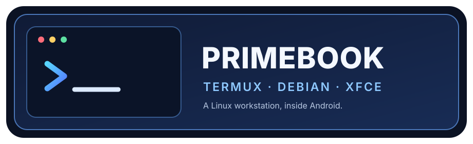

# Termux Debian X11 — PrimeBook

[English](README.md) · **Русский**

> Запускайте рабочий стол Debian + XFCE внутри Termux на Android без root-доступа.



## Возможности
- Debian через Termux, Termux:X11 и PRoot-Distro.
- Рабочий стол XFCE и полезные Linux-приложения.
- Ограниченный доступ к папке Android Downloads.
- KDE Discover, тема WhiteSur и дополнительная поддержка принтеров.
- Команды запуска/остановки, проверки безопасности и обслуживания.

## Установка
Установите Termux, Termux:X11, Termux:API и (при необходимости) Termux:Widget из совместимых источников. Затем в Termux:

```bash
pkg update && pkg upgrade -y
pkg install -y git
git clone https://github.com/bhuvan0x/Termux-Debian-X11.git
cd Termux-Debian-X11
bash scripts/setup-termux.sh
bash scripts/install-debian.sh
bash scripts/harden-debian.sh
bash scripts/security-audit.sh
```

Откройте Termux:X11 и выполните `start-all`.

## Удаление
**Внимание:** команда удаляет Debian PRoot и все файлы внутри него.

```bash
uninstall-primebook
```

Чтобы также удалить локальную копию репозитория: `bash scripts/uninstall.sh --remove-repo`

## Безопасность и ограничения
PRoot — не полноценная виртуальная машина и не контейнер с изоляцией на уровне ядра. Подробности: [SECURITY.md](SECURITY.md), лицензия: [LICENSE](LICENSE).

## Участие и сотрудничество
Свободно используйте, форкайте, улучшайте и изменяйте проект. Предлагайте изменения через Issues и Pull Requests. Хотите работать над проектом вместе? Свяжитесь со мной через GitHub: [@bhuvan0x](https://github.com/bhuvan0x).

[Руководство по установке](docs/INSTALLATION.md) · [Решение проблем](docs/TROUBLESHOOTING.md) · [README на английском](README.md)
